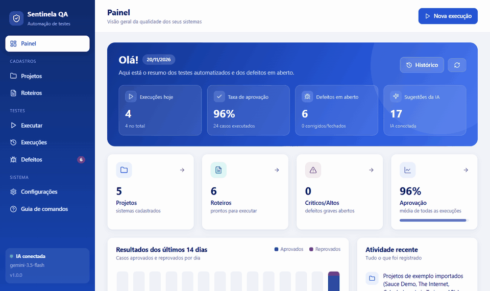
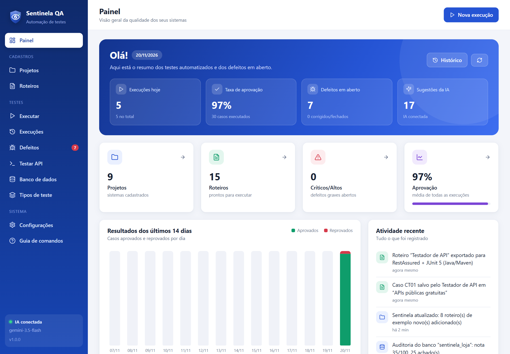
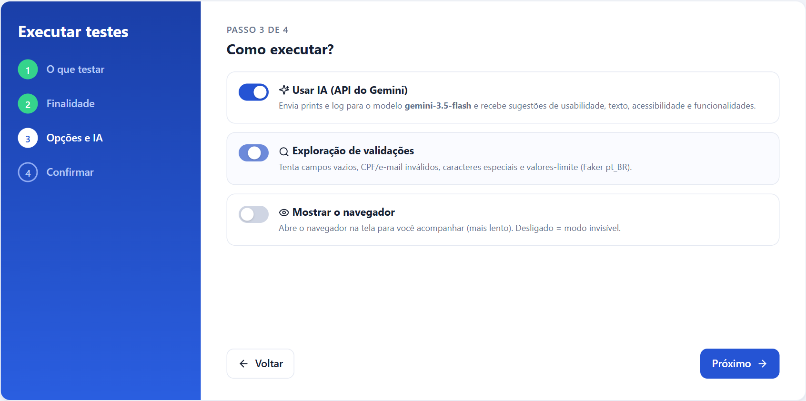
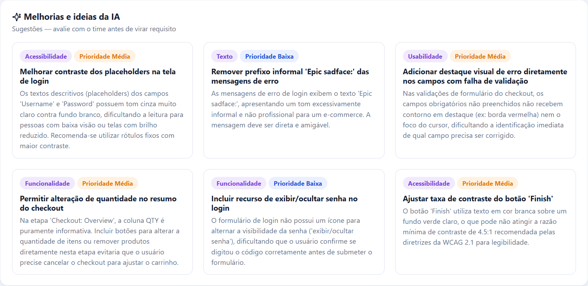
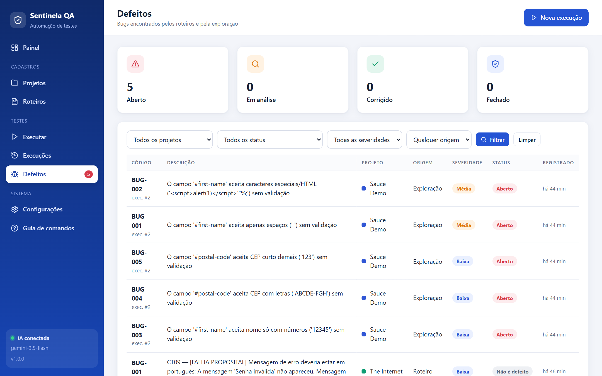
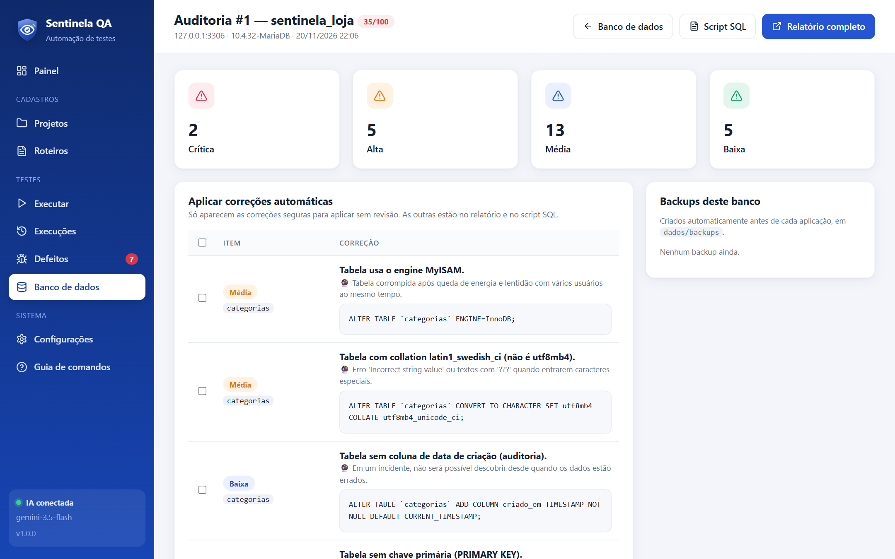
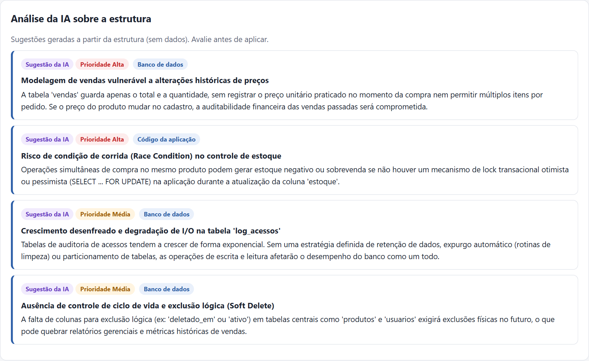
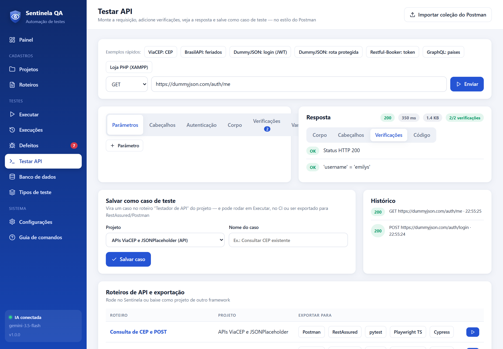
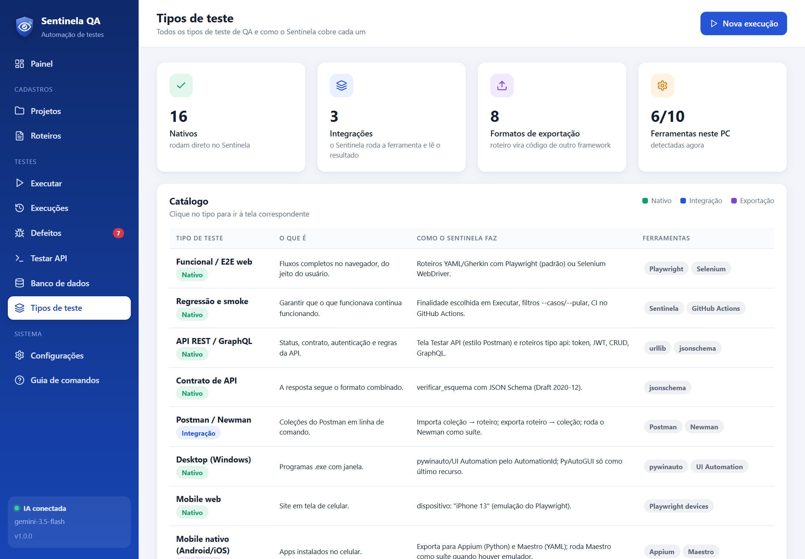
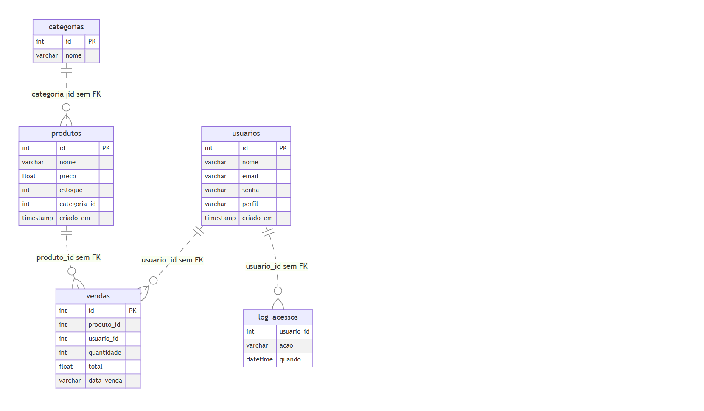

<p align="center"></p>

# Sentinela QA 🛡️✅

[](https://github.com/zrebouca/sentinela-qa/actions/workflows/testes.yml)


🇧🇷 **[Leia em português](README.md)** · 🎬 **[Live demo and reports](https://zrebouca.github.io/sentinela-qa/)**



**A quality watchdog for web apps, Windows desktop apps, APIs and databases.** A dashboard where you register the
systems under test, write test scripts, launch runs choosing the **purpose** and **whether to use AI**,
follow them live and manage the defects found — plus a **MySQL/MariaDB (XAMPP) schema auditor** that tells you
what to change, how, where to act and which problems are likely to show up in the future.

> The UI, messages, reports and code comments are in **Brazilian Portuguese** (it was built for the Brazilian
> market and for junior QA analysts). This page explains everything in English.

## Why I built it

It is the evolution of an old automation of mine: Python + PyAutoGUI scripts that filled in forms by
**clicking screen coordinates**, with fixed sleeps, no assertions and no report. It worked… until a window moved.

| Before (PyAutoGUI) | Now (Sentinela QA) |
|---|---|
| `pyautogui.click(512, 340)` | `clicar: "#login-button"` or `clicar: "Entrar"` (stable locators) |
| `time.sleep(3)` | automatic waits until the element is ready |
| no checks — "looks like it worked" | assertions: text, URL, element, message, HTTP status, JSON fields |
| no evidence | screenshot of every step + timestamped execution path |
| password inside the script | `{env.PASSWORD}` read from a git-ignored `.env` |
| runs only on my machine | Windows `.exe` + GitHub Actions pipeline |

## Features

- **Web testing** with Playwright (locators by test id, label, role, CSS or text; auto-waits; clean session per test case).
- **Windows desktop testing** with pywinauto / UI Automation (AutomationId), PyAutoGUI only as a last resort.
- **API testing** (REST/JSON) without a browser: status, JSON contract, response time, headers, request chaining.
- **Test scripts in YAML/JSON or Gherkin** (`.feature`, Given/When/Then in Portuguese) — readable by QA analysts with little coding.
- **Validation exploration**: empty fields, invalid Brazilian ID (CPF) and e-mail, special characters, boundary values (Faker pt_BR). Accepted invalid input becomes a defect.
- **Automatic observations**: basic accessibility checks (missing `alt`, unlabeled inputs, no `lang`), console errors and HTTP 4xx/5xx.
- **AI review (optional, Gemini)**: screenshots + log are sent to the model, which suggests usability, copy, accessibility and feature improvements — clearly marked as *suggestions*. Toggle per run; the key lives only in `.env`.
- **Reports** in HTML, JSON and TXT: summary, test cases (ID, steps, expected, actual, PASSED/FAILED), defects (severity, steps to reproduce, evidence), findings, AI ideas and the full execution path.
- **Dashboard** (Flask + SQLite, runs locally): projects, script editor with validation, run wizard, live log, defect lifecycle (Open → In analysis → Fixed → Closed), **CSV export** and **copy-to-Jira** text.
- **CI/CD**: GitHub Actions runs unit + integration tests and a regression suite on every push.
- **Database auditor (MySQL/MariaDB, XAMPP)**: connects with user/password, reads only the *structure* (information_schema)
  and reports security (root without password, MD5/plain-text passwords — counted, never read), structure (no primary key,
  MyISAM), integrity (missing foreign keys, orphan rows, duplicate CPF/e-mail), performance (unindexed relationship columns),
  data types (money in FLOAT, dates as text), server settings and **future risks** (AUTO_INCREMENT limit, 12-month growth).
  Each finding has *why it matters*, *likely future problem*, *where to act* and the *SQL fix*. Safe fixes can be applied from
  the dashboard after typing the database name — always with an automatic **mysqldump backup** and a restore button.
  Optional AI review receives the schema only.
- **Database checks inside tests**: `verificar_banco`, `consultar_banco`, `preparar_banco` prove that a UI/API action was
  really saved in MySQL.
- **Extra quality checks with free libraries**: accessibility with **axe-core (WCAG 2.1)**, API contracts with **JSON Schema**,
  **visual regression** (Pillow), **performance** (load time, TTFB, LCP), **load testing** (throughput, p95), **security headers**
  and cookie flags, **broken links**, plus **mobile emulation** (`dispositivo: "iPhone 13"`).
- **Practice systems with planted bugs**: a local HTML store, a **PHP 8 + MySQL store with REST API on XAMPP**
  (`sentinela xampp instalar`) and an **inventory desktop app in C# Windows Forms** compiled automatically with the
  `csc.exe` that ships with Windows.
- **API tester screen (Postman-style)**: build requests (params, headers, Bearer/Basic/API-key auth, JSON body), add checks
  (status, JSON field equals/contains/exists/type, response time, header, **JSON Schema**), chain requests with `{{variables}}`
  (e.g. save the login `accessToken` and reuse it), generate cURL/Python/JS/RestAssured/Postman-test code, **save as a test
  case** and **import Postman v2.1 collections** (common `pm.test` assertions become Sentinela checks).
- **Every kind of QA test and the market tools** — three ways:
  - *Alternative engine*: web scripts can run on **Selenium WebDriver** (`motor: selenium`) instead of Playwright.
  - *Suites* (`tipo: suite`): Sentinela runs **Pytest, Jest, Vitest, Cypress, Newman, Playwright TS, JUnit 5/TestNG (Maven)
    or Maestro** and reads the standard **JUnit XML**, so results land in the same report, history and defect tracking.
  - *Export*: any script becomes ready-to-run code for **Playwright TS, Cypress, Selenium + pytest, pytest + requests,
    RestAssured + JUnit 5, a Postman collection, Appium or Maestro** (`sentinela exportar` or the "Export to…" menu).
  - Verified on this machine: Pytest (16 passed + the planted bug), Jest (7 passed + the planted bug), Newman on an exported
    collection (16/16), exported Playwright TS (6/6), exported Selenium + pytest (6/6), exported pytest + requests (4/4).
  - A **Test types** page lists the whole catalog (functional, regression, API, contract, Postman, desktop, mobile web/native,
    unit, components, BDD, exploratory, database, accessibility, performance, load, security, visual, links, AI usability)
    and which tools are installed on the PC.
- **Free public APIs, no keys**: BrasilAPI, Restful-Booker (token + full CRUD), DummyJSON (JWT), PokeAPI (JSON Schema),
  Countries (GraphQL) and Open-Meteo.

## Screenshots

| Dashboard | Run wizard (purpose, AI on/off, exploration) |
|---|---|
|  |  |
| **AI suggestions** | **Defects found by exploration** |
|  |  |
| **Database audit** (health score, fixes with backup) | **AI review of the schema** |
|  |  |

| **API tester** (login → token variable → protected route) | **Test types catalog** |
|  |  |

**Relationship diagram** — dashed lines are relationships that exist only in the code (no foreign key):


## Quick start

Requirements: **Windows 10/11**, **Python 3.11+** and **Google Chrome** (or Microsoft Edge). No `playwright install` needed.

```bash
git clone https://github.com/zrebouca/sentinela-qa.git
cd sentinela-qa
python -m venv .venv
.venv\Scripts\activate
pip install -r requirements.txt
python -m sentinela painel
```

The dashboard opens at `http://127.0.0.1:8765`. Click **"Importar exemplos prontos"** to load 5 demo projects
(Sauce Demo, The Internet, Windows Calculator, the local practice store and public APIs), then go to **Executar**.

Command line:

```bash
python -m sentinela rodar --roteiro roteiros/web_saucedemo.yaml --explorar --abrir
python -m sentinela rodar --roteiro roteiros/api_viacep.yaml --sem-ia
python -m sentinela rodar --roteiro roteiros/web_the_internet.yaml --pular CT09
python -m sentinela gherkin --roteiro roteiros/web_site_treino.yaml --arquivo login.feature
python -m sentinela site-treino
```

| Command | What it does |
|---|---|
| `painel` | opens the dashboard (also what double-clicking the `.exe` does) |
| `rodar` (run) | runs a script; flags: `--alvo` target, `--explorar` exploration, `--sem-ia` no AI, `--visivel` headed browser, `--casos`/`--pular` filter cases, `--embutir-prints` single-file HTML |
| `validar` | validates a script without running it |
| `gherkin` | converts a YAML script into a `.feature` file |
| `site-treino` | serves the local practice store on port 8000 |
| `banco auditar --banco X` | audits a MySQL/MariaDB database (`--ia` for the AI review); `banco aplicar --correcoes C001 --confirmar` applies fixes after a backup |
| `exportar --roteiro X --para cypress --saida pasta` | exports a script to playwright-ts, cypress, selenium-py, pytest-api, restassured, postman, appium-py or maestro |
| `postman --colecao c.json --arquivo r.yaml` | imports a Postman v2.1 collection as a Sentinela script |
| `xampp iniciar` / `xampp instalar` | starts XAMPP's MySQL + Apache / installs the PHP practice store and its database |
| `novo` | creates a script template |

Exit code: `0` all passed · `1` failures/defects · `2` invalid script — so the CI pipeline turns red when a test fails.

## Writing a test script

```yaml
sistema: My Store            # system
versao: "2.3.1"              # version
responsavel: Your Name       # owner
objetivo: Validate login.    # objective
alvo: https://www.saucedemo.com   # target (URL, API base URL or .exe)

casos:                       # test cases
  - id: CT01
    descricao: Login with a valid user
    esperado: Products page is shown        # expected result
    severidade: Alta                         # severity if it fails
    passos:                                  # steps
      - abrir: /                             # open
      - preencher: { campo: "#user-name", valor: standard_user }   # fill
      - preencher: { campo: "#password", valor: "{env.SAUCE_SENHA|secret_sauce}" }
      - clicar: "#login-button"              # click
      - verificar_url: inventory             # assert URL
      - verificar_texto: Products            # assert text
```

Main commands (Portuguese → meaning): `abrir` open · `logar` log in · `cadastrar` fill a whole form · `preencher` fill ·
`digitar` type · `buscar` search · `clicar` click · `passar_mouse` hover · `arrastar` drag and drop · `rolar` scroll ·
`apertar_tecla` press key · `esperar` wait for · `selecionar` select option · `marcar` check · `enviar_arquivo` upload ·
`verificar_*` assertions (text, element, URL, title, value, message) · API: `requisitar` request, `verificar_status`,
`verificar_json`, `verificar_tempo`, `verificar_cabecalho`, `guardar` store a value.

Test data placeholders: `{faker.email}`, `{faker.cpf}` (any Faker pt_BR generator), `{env.NAME|default}`, `{dados.key}`.

### API example

```yaml
tipo: api
alvo: https://viacep.com.br
casos:
  - id: CT01
    descricao: Existing ZIP code
    passos:
      - requisitar: GET /ws/01001000/json/
      - verificar_status: 200
      - verificar_json: { campo: localidade, valor: São Paulo }
      - verificar_tempo: { maximo_ms: 2000 }
```

### Gherkin example (Portuguese keywords)

```gherkin
# language: pt
# alvo: http://127.0.0.1:8000
Funcionalidade: Login
  @CT01 @critica
  Cenário: Login with a valid user
    Dado que eu acesso "/index.html"
    Quando eu preencho "rotulo=Usuário" com "qa"
    E eu clico em "Entrar"
    Então a URL deve conter "painel.html"
```

## Local practice store

`site_treino/` is a small fake store (login, search, delayed content and a sign-up form validating CPF, e-mail and ZIP).
It lets the project **test itself without depending on third-party sites**, and it contains a **planted bug**
(the phone field is not validated) that the exploration finds — the integration test asserts exactly that.

## AI setup (optional)

Create a free key at [Google AI Studio](https://aistudio.google.com/apikey), copy `.env.exemplo` to `.env` and set
`GEMINI_API_KEY`. The model is configurable (`SENTINELA_MODELO_IA`); if it is unavailable or slow, Sentinela falls
back to another "flash" model, and the AI step has a hard time limit so reports are always generated.
Without a key everything still works and the report says the AI section was skipped.

## Tests and CI

```bash
pytest -q                       # all, including the browser integration test
pytest -q -m "not integracao"   # fast tests only
```

GitHub Actions ([`testes.yml`](.github/workflows/testes.yml)): unit + integration tests and the local regression suite are
**required**; third-party demo sites and public APIs run as **informational** steps. HTML reports are uploaded as artifacts.

## Project structure

```
sentinela/
  cli.py, motor.py          command line and orchestration (script → executor → exploration → AI → report)
  executor_web.py           Playwright (stable locators, auto-waits, accessibility checks)
  executor_desktop.py       pywinauto UI Automation
  executor_api.py           REST/JSON testing (standard library only)
  gherkin.py                .feature parser (Portuguese) and YAML → Gherkin converter
  exploracao.py, dados.py   invalid-input exploration and Faker test data
  ia.py, relatorio.py       Gemini review and HTML/JSON/TXT reports
  executor_banco.py         database checks inside test scripts
  executor_qualidade.py     axe-core, JSON Schema, visual, performance, load, security, links
  banco_auditor.py          MySQL/MariaDB schema auditor, growth forecast, backup and fixes
  xampp.py                  starts XAMPP and installs the PHP practice store
  executor_selenium.py      alternative web engine (Selenium WebDriver)
  executor_suite.py         runs Pytest/Jest/Vitest/Cypress/Newman/Playwright TS/Maven/Maestro suites (JUnit XML)
  exportar.py, postman.py   code export to 8 formats; Postman collection import/export
  painel/                   Flask + SQLite dashboard
roteiros/                   example scripts (web, desktop, API, Gherkin)
site_treino/                local practice store with a planted bug
sistemas_treino/            PHP + MySQL store (XAMPP) and C# WinForms inventory app, with planted bugs
exemplos_frameworks/        Pytest and Jest example suites + exported Playwright TS, Cypress, Selenium, pytest,
                            RestAssured, Postman/Newman, Appium and Maestro code
tests/                      pytest (unit + integration)
docs/                       GitHub Pages demo and README images
```

## Good practices followed

- No passwords, keys or real data in code or scripts — `{env.X}` + git-ignored `.env`.
- Only demo sites, public test APIs or the local practice store are automated.
- Independent test cases (clean browser session each), assertions instead of fixed waits.

---

Built by **Mateus** — QA portfolio project. I'm looking for my first **Junior QA Analyst** role (open to remote). Feedback is very welcome!
