<p align="center"></p>

# Sentinela QA 🛡️✅

[](https://github.com/zrebouca/sentinela-qa/actions/workflows/testes.yml)


🇬🇧 **[Read in English](README.en.md)** · 🎬 **[Demo e relatórios ao vivo](https://zrebouca.github.io/sentinela-qa/)**

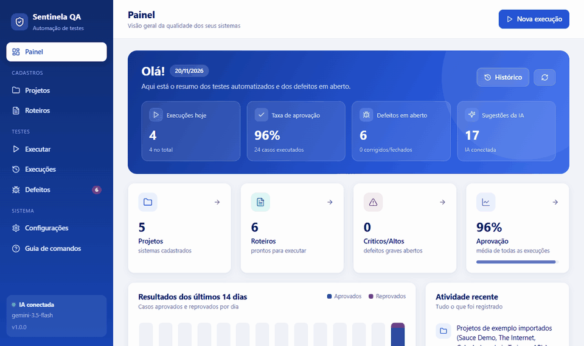

**Seu vigia de qualidade para sistemas web, desktop, APIs e bancos de dados.** Um painel onde você cadastra os sistemas,
escreve os roteiros de teste, dispara execuções escolhendo a **finalidade** e **se usa IA ou não**,
acompanha ao vivo e gerencia os defeitos encontrados — e ainda **audita a estrutura do banco MySQL/MariaDB (XAMPP)**,
dizendo o que mudar, como mudar, onde agir e quais problemas devem aparecer no futuro.

Por baixo: automação de testes **web, desktop e API** guiada por **roteiros simples em YAML/JSON ou Gherkin**,
com **print de cada passo**, **exploração de validações** com massa de dados (Faker pt_BR),
**sugestões de melhoria por IA** (Gemini) e **relatório HTML/JSON/TXT** no formato usado por QA:
cabeçalho, objetivo, critérios de aceitação, casos de teste e defeitos.

> **De onde veio:** é a evolução de uma automação antiga minha em PyAutoGUI que preenchia
> cadastros clicando por **coordenadas de tela**, com esperas fixas, sem asserções e sem relatório.
> Aqui troquei tudo isso por **seletores estáveis** (Playwright / UI Automation), **esperas automáticas**,
> **verificações (asserções)**, **relatório com evidências**, **credenciais fora do código** e **CI no GitHub Actions**.

| Antes (PyAutoGUI)                         | Agora (Sentinela QA)                                                   |
|-------------------------------------------|-------------------------------------------------------------------|
| `pyautogui.click(512, 340)`                | `clicar: "#login-button"` ou `clicar: "Entrar"`                   |
| `time.sleep(3)`                            | espera automática até o elemento aparecer (limite configurável)   |
| sem verificação: "parece que funcionou"    | `verificar_texto`, `verificar_url`, `verificar_mensagem`...        |
| sem evidência                              | print de cada passo + caminho percorrido com horário              |
| senha no script                            | `{env.SENHA}` lido do `.env` (fora do Git)                        |
| roda só na minha máquina                   | `.exe` para Windows + pipeline no GitHub Actions                  |

## Telas

**Painel** — indicadores, resultados dos últimos 14 dias, atividade recente e pendências
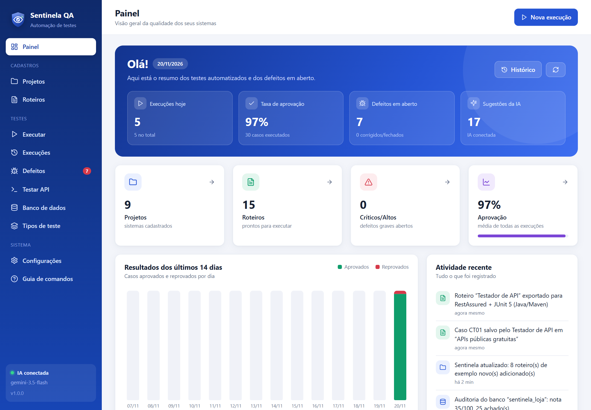

**Nova execução** — finalidade, usar IA ou não, exploração de validações
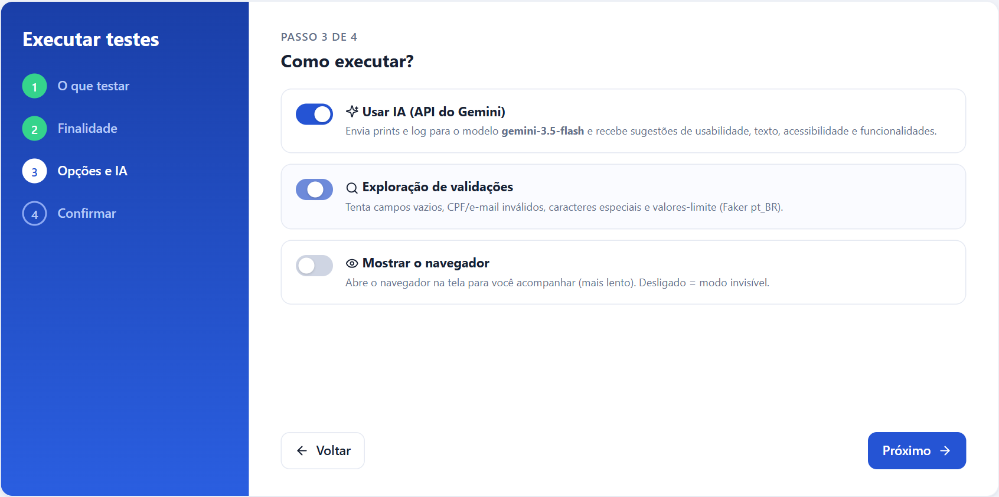

**Sugestões da IA** a partir dos prints da execução (Sauce Demo)
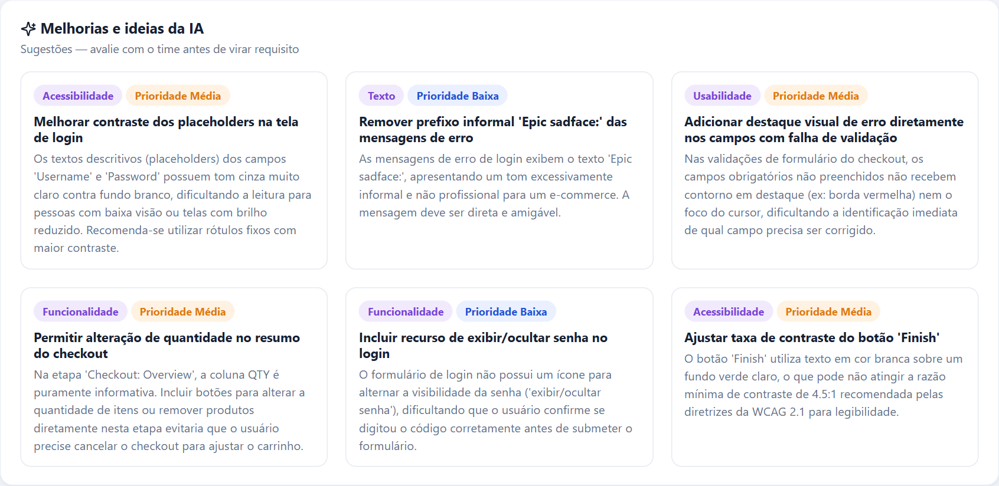

**Defeitos** encontrados pela exploração (o formulário aceita CEP com letras, nome só com espaços...)
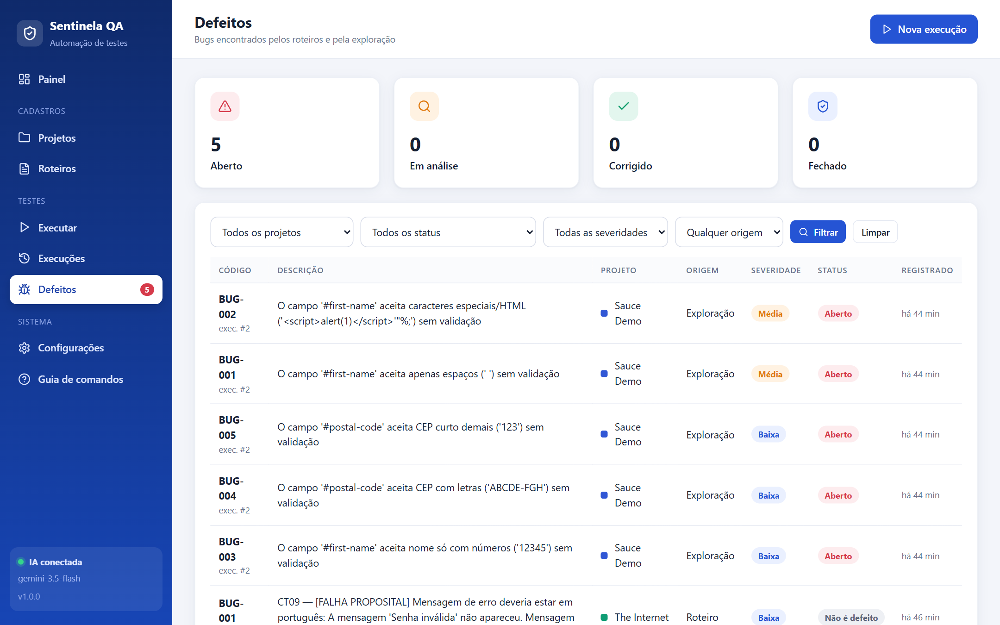

**Auditoria de banco de dados** (MySQL/MariaDB do XAMPP) — nota de saúde, problemas, previsões e correções com backup
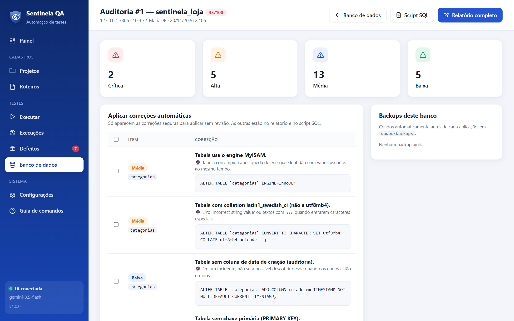

**Análise da IA sobre a estrutura do banco** (só a estrutura é enviada, nunca os dados) e **diagrama** com os relacionamentos sem FK
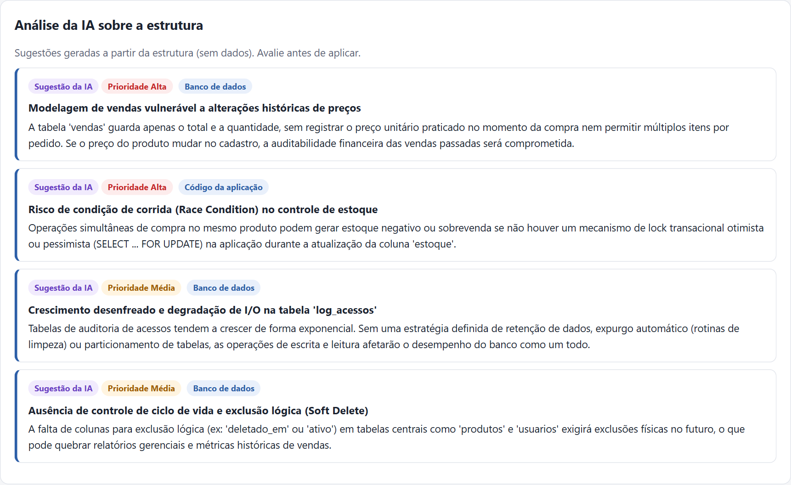
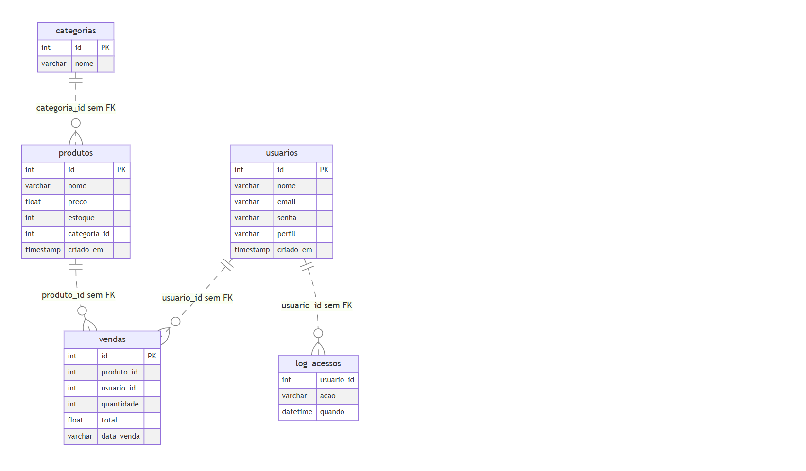

<details><summary>Mais telas: conexão com o banco, relatório da auditoria, projetos e relatório de testes</summary>

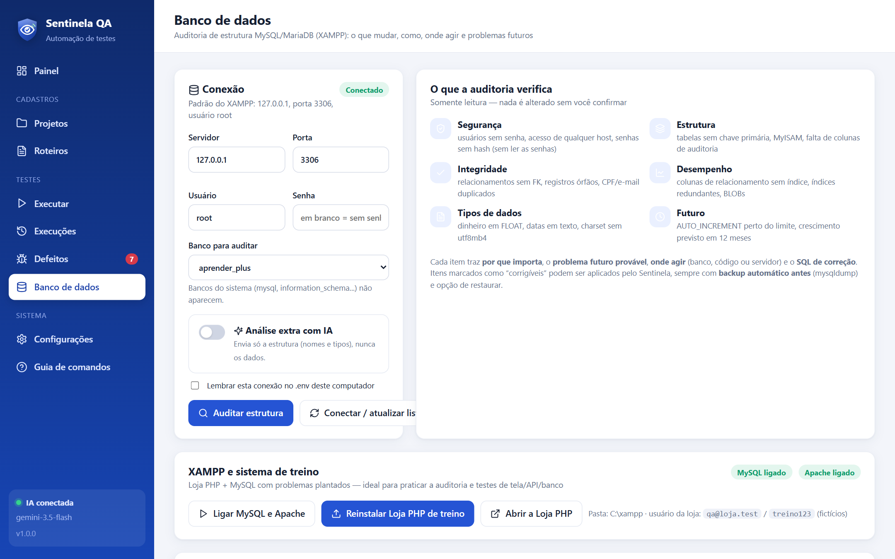
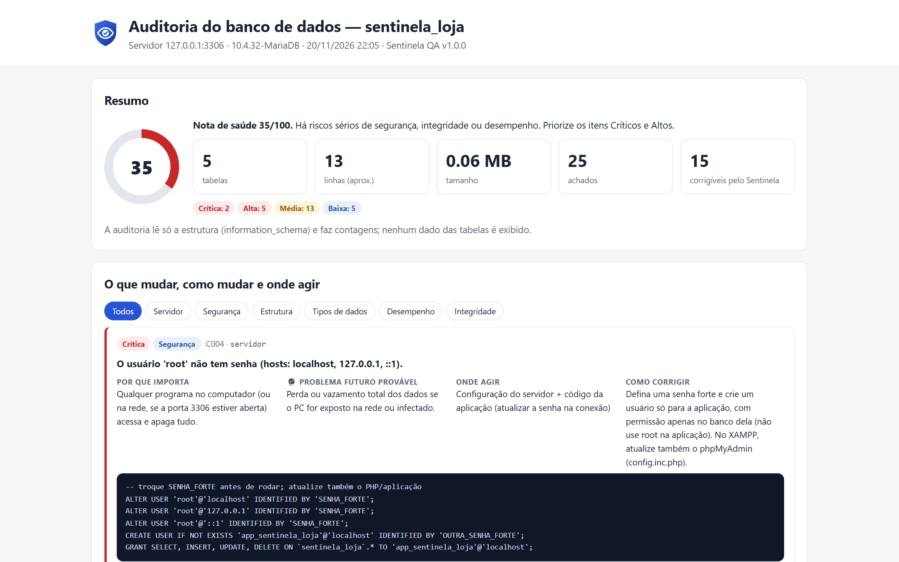

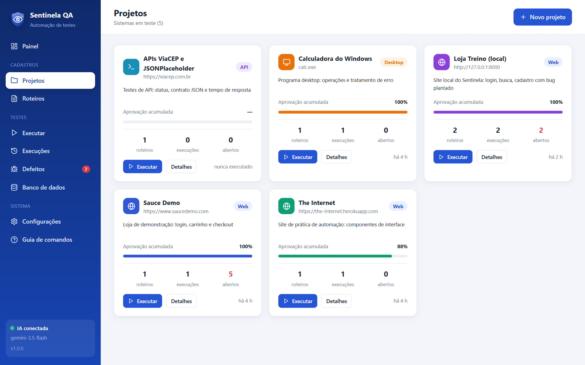
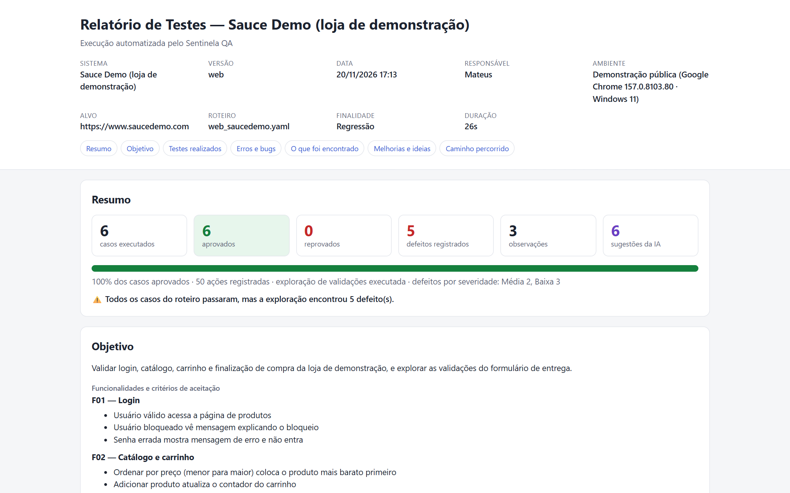
</details>

---

## Sumário
1. [O que ele faz](#o-que-ele-faz)
2. [Instalação](#instalação)
3. [Como usar](#como-usar)
4. [Escrevendo um roteiro](#escrevendo-um-roteiro)
5. [Testes de API](#testes-de-api)
6. [Gherkin (BDD)](#gherkin-bdd)
7. [Exploração de validações](#exploração-de-validações)
8. [Site de treino local](#site-de-treino-local)
9. [Testar API (estilo Postman)](#testar-api-estilo-postman)
10. [Todos os tipos de teste e outros frameworks](#todos-os-tipos-de-teste-e-outros-frameworks)
11. [Qualidade extra: acessibilidade, contrato, visual, desempenho, carga, segurança](#qualidade-extra)
12. [Banco de dados: auditoria e testes (XAMPP)](#banco-de-dados-auditoria-e-testes-xampp)
13. [Sistemas de treino (site, Loja PHP, Estoque Desktop)](#sistemas-de-treino)
14. [APIs públicas gratuitas](#apis-públicas-gratuitas)
15. [Configurando a IA](#configurando-a-ia)
16. [Lendo o relatório e exportando defeitos](#lendo-o-relatório)
17. [CI/CD](#cicd)
18. [Gerando o .exe](#gerando-o-exe)
19. [Estrutura do projeto](#estrutura-do-projeto)

---

## O que ele faz

1. Você informa o **alvo**: a URL de um site, a URL de uma **API** **ou** o caminho de um `.exe`.
2. Você escreve um **roteiro** com casos de teste, passos e critérios de sucesso.
3. O Sentinela executa tudo sozinho, **tira print de cada passo** e registra o **caminho percorrido**.
4. *(Opcional)* Faz uma **exploração leve**: campos vazios, CPF/e-mail inválidos, caracteres especiais,
   textos longos… para achar falhas de validação.
5. *(Opcional)* Envia prints + log para a **IA** e recebe sugestões de usabilidade, texto,
   acessibilidade e funcionalidades.
6. Gera o **relatório** (HTML bonito + JSON + TXT) com: Resumo · Testes realizados · Erros e bugs ·
   O que foi encontrado · Melhorias e ideias · Caminho percorrido.

Além disso, a cada página web aberta ele faz uma **checagem básica de acessibilidade**
(imagens sem `alt`, campos sem `<label>`, botões sem texto, página sem idioma) e anota
**erros de console e de rede** (HTTP 4xx/5xx).

## Instalação

Pré-requisitos: **Windows 10/11**, **Python 3.11+** e **Google Chrome** (ou Microsoft Edge).

```bash
git clone https://github.com/zrebouca/sentinela-qa.git
```

```bash
cd sentinela-qa
```

```bash
python -m venv .venv
```

```bash
.venv\Scripts\activate
```

```bash
pip install -r requirements.txt
```

Não é preciso rodar `playwright install`: o Sentinela usa o Chrome (ou Edge) que já está instalado.

> **Só quer usar, sem Python?** Baixe a pasta `sentinela` com o `sentinela.exe` (veja [Gerando o .exe](#gerando-o-exe)).

## Como usar

### Pelo painel (mais fácil)
Dê dois cliques no `sentinela.exe` (ou rode `python -m sentinela painel`). O painel abre no navegador
em `http://127.0.0.1:8765` — ele roda **só no seu computador**, nada fica exposto na rede.

| Tela | O que faz |
|---|---|
| **Painel** | indicadores (execuções, taxa de aprovação, defeitos abertos, sugestões da IA), gráfico dos últimos 14 dias, atividade recente, ações rápidas, saúde por projeto e pendências |
| **Projetos** | cadastro dos sistemas em teste: nome, tipo (web/desktop), alvo, **finalidade**, versão, responsável, ambiente e cor |
| **Roteiros** | editor YAML com **validação antes de salvar**, importação de arquivo e modelo pronto |
| **Executar** | assistente em 4 passos: o que testar → **finalidade** (regressão, smoke, aceitação, exploratório, validação de correção...) → opções (**usar a API de IA ou não**, exploração, navegador visível) → confirmar |
| **Execuções** | histórico, **log ao vivo**, defeitos, sugestões da IA, observações, relatório embutido, **comando equivalente** para CI e botão "Executar de novo" |
| **Testar API** | monta requisições estilo Postman, com verificações, variáveis (token), código gerado, salvar como caso e importar coleções do Postman |
| **Tipos de teste** | catálogo de todos os tipos de teste de QA, ferramentas instaladas e exportação para outros frameworks |
| **Banco de dados** | conecta no MySQL/MariaDB (XAMPP) com usuário e senha, **audita a estrutura** e aplica correções com **backup automático**; liga o XAMPP e instala a Loja PHP de treino |
| **Defeitos** | todos os bugs com filtros (projeto, status, severidade, origem), evidência e ciclo de vida **Aberto → Em análise → Corrigido → Fechado** com comentário |
| **Configurações** | chave e modelo da IA (gravados só no `.env`), botão **Testar conexão**, preferências e importação dos exemplos |
| **Guia de comandos** | referência de todos os comandos, seletores, marcadores e exploração |

Tudo fica registrado num banco **SQLite** local (`dados/sentinela.db`) e os relatórios em `dados/relatorios/`.
Na primeira abertura, clique em **Importar exemplos prontos** para ter 8 projetos de demonstração (web, desktop, APIs, Loja PHP e Estoque Desktop).

### Pela linha de comando

```bash
python -m sentinela rodar --roteiro roteiros/web_saucedemo.yaml --explorar --abrir
```

Com o executável é igual, trocando `python -m sentinela` por `sentinela.exe`:

```bash
sentinela.exe rodar --alvo calc.exe --roteiro roteiros/desktop_calculadora.yaml
```

| Opção               | Para que serve                                                        |
|---------------------|-----------------------------------------------------------------------|
| `--roteiro ARQ`     | arquivo `.yaml`/`.json` com os casos (obrigatório)                    |
| `--alvo URL/EXE`    | sobrepõe o `alvo` escrito no roteiro                                  |
| `--explorar`        | roda a exploração de validações (seção `exploracao` do roteiro)       |
| `--sem-ia`          | não chama a IA                                                        |
| `--visivel`         | mostra o navegador enquanto testa                                     |
| `--embutir-prints`  | coloca os prints dentro do HTML (um arquivo só, fácil de mandar)      |
| `--saida PASTA`     | onde salvar (padrão `relatorios/`)                                    |
| `--abrir`           | abre o relatório no navegador ao terminar                             |

Outros comandos:

```bash
python -m sentinela validar --roteiro meu_roteiro.yaml
```

```bash
python -m sentinela novo --arquivo meu_roteiro.yaml
```

**Código de saída:** `0` = tudo aprovado · `1` = algum caso reprovado ou defeito · `2` = roteiro com erro.
Isso faz o pipeline de CI ficar vermelho quando um teste falha.

### Roteiros de exemplo (todos em sites/programas de demonstração)

| Arquivo                               | Alvo                                   | O que mostra |
|---------------------------------------|----------------------------------------|--------------|
| `roteiros/web_saucedemo.yaml`         | https://www.saucedemo.com              | login, usuário bloqueado, ordenação, carrinho, checkout com Faker, **exploração** |
| `roteiros/web_the_internet.yaml`      | https://the-internet.herokuapp.com     | hover, arrastar e soltar, upload, teclas, checkbox, dropdown, conteúdo dinâmico, rolagem e **um caso com falha proposital (CT09)** |
| `roteiros/desktop_calculadora.yaml`   | `calc.exe` (Calculadora do Windows)    | teste desktop por AutomationId, teclado e mensagem de erro |
| `roteiros/web_site_treino.yaml`       | site de treino local (`sentinela site-treino`) | login, busca, conteúdo dinâmico, cadastro com CPF; a exploração acha o **bug plantado** |
| `roteiros/gherkin_site_treino.feature`| site de treino local                   | os mesmos testes escritos em **Gherkin** (Dado/Quando/Então) |
| `roteiros/api_viacep.yaml`            | https://viacep.com.br + JSONPlaceholder | **testes de API**: status, contrato JSON, tempo de resposta, POST, encadeamento |
| `roteiros/api_publicas.yaml`          | BrasilAPI, Restful-Booker, DummyJSON, PokeAPI, Countries, Open-Meteo | autenticação com **token e JWT**, **CRUD completo**, **GraphQL**, JSON Schema — tudo **sem chave** |
| `roteiros/suite_tempo_real.yaml`      | Chat de treino (sobe sozinho) | **tempo real**: mensagens entre telas, queda e reconexão, **push**, **chamada de áudio e vídeo (WebRTC)** e 5 aparelhos **emulados** no Chrome (não substitui aparelho real) |
| `roteiros/web_loja_php.yaml`          | Loja PHP no XAMPP (`sentinela xampp instalar`) | tela + API REST + **conferência no banco MySQL** + acessibilidade (axe) + carga + exploração |
| `roteiros/desktop_estoque.yaml`       | Estoque Desktop (WinForms, compilado sozinho) | sistema desktop **de verdade**: login, cadastro, combo, busca e um **bug plantado** |

As credenciais dos exemplos são as **públicas** publicadas pelos próprios sites de demonstração.

## Escrevendo um roteiro

Um roteiro é um arquivo de texto. Linhas com `#` são comentários.

```yaml
sistema: Minha Loja
versao: "2.3.1"
responsavel: Seu Nome
ambiente: Homologação
objetivo: Validar o login.
alvo: https://www.saucedemo.com
tempo_limite: 10              # segundos máximos de espera em cada passo

dados:                        # valores gerados uma vez e reaproveitados com {dados.nome}
  senha: "{env.SAUCE_SENHA|secret_sauce}"   # do .env; se não existir, usa o padrão
  nome: "{faker.first_name}"

funcionalidades:
  - id: F01
    nome: Login
    criterios:
      - Usuário válido entra na loja

antes_de_cada:                # passos repetidos no começo de todo caso (opcional)
  - abrir: /

casos:
  - id: CT01
    funcionalidade: F01
    descricao: Login com usuário válido
    esperado: A página de produtos aparece
    severidade: Alta          # Crítica | Alta | Média | Baixa (usada se o caso falhar)
    passos:
      - preencher: { campo: "#user-name", valor: standard_user }
      - preencher: { campo: "#password", valor: "{dados.senha}" }
      - clicar: "#login-button"
      - verificar_url: inventory
      - verificar_texto: Products
```

### Comandos

| Comando | Exemplo | Observação |
|---|---|---|
| `abrir` | `abrir: /login` | URL relativa ao alvo ou completa |
| `logar` | `logar: { usuario: x, senha: "{env.SENHA}" }` | acha os campos sozinho; aceita `campo_usuario`, `campo_senha`, `botao` |
| `cadastrar` | `cadastrar: { campos: { "#nome": "{faker.name}" }, enviar: "Salvar" }` | preenche vários campos de uma vez |
| `preencher` | `preencher: { campo: "rotulo=E-mail", valor: "{faker.email}" }` | apaga e escreve |
| `digitar` | `digitar: { campo: "#busca", texto: "notebook" }` | tecla por tecla |
| `buscar` | `buscar: { termo: "notebook" }` | preenche a busca e aperta Enter |
| `clicar` / `clicar_duplo` | `clicar: "Entrar"` | |
| `passar_mouse` | `passar_mouse: ".menu"` | |
| `arrastar` | `arrastar: { de: "#a", para: "#b" }` | |
| `rolar` | `rolar: fim` · `rolar: { ate: "#rodape" }` | `baixo`, `cima`, `topo`, `fim` ou pixels |
| `apertar_tecla` | `apertar_tecla: Enter` · `apertar_tecla: { tecla: Tab, campo: "#x" }` | `Ctrl+A` também funciona |
| `esperar` | `esperar: { texto: "Pronto" }` · `esperar: { sumir: "#loading" }` | evite `esperar: 2` (espera fixa) |
| `selecionar` | `selecionar: { campo: "#estado", opcao: "Bahia" }` | |
| `marcar` / `desmarcar` | `marcar: "#aceito"` | checkbox |
| `enviar_arquivo` | `enviar_arquivo: { campo: "#upload", arquivo: arquivos/doc.pdf }` | caminho relativo ao roteiro |
| `recarregar`, `voltar`, `capturar_tela`, `fechar` | `- recarregar` | |
| **`verificar_texto`** | `verificar_texto: "Bem-vindo"` · `{ elemento: "#saldo", texto: "R$ 10" }` | |
| **`verificar_sem_texto`** | `verificar_sem_texto: "Erro"` | |
| **`verificar_elemento`** | `verificar_elemento: "#logout"` · `{ alvo: ".item", quantidade: 3 }` | |
| **`verificar_url`** | `verificar_url: /painel` · `{ igual: "https://..." }` | |
| **`verificar_titulo`** | `verificar_titulo: "Painel"` | |
| **`verificar_valor`** | `verificar_valor: { campo: "#cep", valor: "01001000" }` | |
| **`verificar_mensagem`** | `verificar_mensagem: { tipo: sucesso, texto: "Salvo!" }` | procura em alertas/toasts/flash |

Nomes alternativos também funcionam: `login`, `procurar`, `pesquisar`, `hover`, `upload`, `aguardar`, `print`...

### Como apontar para um elemento

**Web (Playwright)** — prefira, nesta ordem, o que é mais estável:

| Forma | Exemplo |
|---|---|
| test id | `testid=login-button` (o atributo padrão é `data-testid`; troque com `atributo_testid: data-test`) |
| rótulo do campo | `rotulo=E-mail` |
| papel + nome (acessibilidade) | `papel=button:Entrar` |
| id / CSS | `#user-name`, `.btn-primary`, `input[name=email]` |
| texto | `texto=Esqueci minha senha` |
| placeholder | `placeholder=Buscar` |
| sem prefixo | `Entrar` → tenta rótulo, placeholder, botão, link e texto |

**Desktop (pywinauto / UI Automation):** `id=num7Button` (AutomationId, o mais estável),
`nome=Sete`, `tipo=Button;nome=Igual a`. Como **último recurso**: `clicar: { x: 120, y: 300 }`
(coordenada relativa à janela, via PyAutoGUI). Para descobrir ids, use o
[Accessibility Insights for Windows](https://accessibilityinsights.io/docs/windows/overview/).
Em roteiros desktop, informe `janela:` com o título da janela (expressão regular).

### Massa de dados

| Marcador | Resultado |
|---|---|
| `{faker.name}`, `{faker.email}`, `{faker.cpf}`, `{faker.cellphone_number}`, `{faker.postcode}` | dados falsos brasileiros (qualquer gerador do [Faker](https://faker.readthedocs.io/en/master/locales/pt_BR.html)) |
| `{env.NOME}` / `{env.NOME\|padrão}` | variável de ambiente ou do `.env` |
| `{dados.chave}` | valor da seção `dados:` (gerado uma vez por execução) |

## Testes de API

Use `tipo: api` no roteiro (roda sem navegador) — ou misture passos de API num roteiro web.
A resposta de cada requisição é salva como **evidência** (`.json`) no relatório.

```yaml
tipo: api
alvo: https://viacep.com.br
casos:
  - id: CT01
    descricao: Consultar CEP existente
    passos:
      - requisitar: GET /ws/01001000/json/
      - verificar_status: 200
      - verificar_cabecalho: { nome: content-type, contem: json }
      - verificar_json: { campo: localidade, valor: São Paulo }
      - verificar_json: { campo: logradouro, contem: Praça da Sé }
      - verificar_tempo: { maximo_ms: 2000 }
  - id: CT02
    descricao: Criar recurso e encadear
    passos:
      - requisitar: { metodo: POST, url: https://jsonplaceholder.typicode.com/posts, corpo: { title: Teste } }
      - verificar_status: 201
      - guardar: { campo: id, como: novo_id }          # use depois como {dados.novo_id}
```

| Comando | Exemplo |
|---|---|
| `requisitar` | `GET /caminho` ou `{ metodo, url, corpo, cabecalhos, consulta }` |
| `verificar_status` | `200` ou `{ entre: [200, 299] }` |
| `verificar_json` | `{ campo: "itens[0].nome", valor: X }` · `{ contem: X }` · `{ existe: false }` · `{ tipo: lista, quantidade: 3 }` |
| `verificar_tempo` | `{ maximo_ms: 2000 }` |
| `verificar_cabecalho` | `{ nome: content-type, contem: json }` |
| `guardar` | `{ campo: id, como: novo_id }` |

## Gherkin (BDD)

Roteiros também podem ser escritos em **Gherkin em português** (arquivo `.feature`), no estilo Cucumber:

```gherkin
# language: pt
# alvo: http://127.0.0.1:8000
Funcionalidade: Login e cadastro na Loja Treino

  @CT01 @critica
  Cenário: Login com usuário válido
    Dado que eu acesso "/index.html"
    Quando eu preencho "rotulo=Usuário" com "qa"
    E eu preencho "rotulo=Senha" com "{env.TREINO_SENHA|treino123}"
    E eu clico em "Entrar"
    Então a URL deve conter "painel.html"
    E devo ver "Bem-vindo, qa!"
```

- Tags: `@CT01` vira o ID do caso; `@critica`, `@alta`, `@media`, `@baixa` viram a severidade.
- `Contexto:` vira os passos repetidos antes de cada cenário.
- Converter um roteiro YAML existente: `python -m sentinela gherkin --roteiro roteiros/web_site_treino.yaml --arquivo login.feature`
- A lista completa de frases aceitas está no **Guia de comandos** do painel.

## Exploração de validações

Rode com `--explorar`. Para cada campo listado, o Sentinela preenche os **outros** campos com dados válidos,
coloca um valor **inválido** no campo em teste, envia e observa:

- **bloqueou** (mensagem de erro ou validação do navegador) → vira observação positiva;
- **aceitou** e seguiu adiante → vira **defeito** (origem "Exploração") com passos e print.

```yaml
exploracao:
  preparar:                         # como chegar até o formulário
    - abrir: /cadastro
  campos:
    "#nome":  { tipo: nome }
    "#email": { tipo: email }
    "#cpf":   { tipo: cpf, testes: [vazio, cpf_repetido, cpf_digito] }   # escolher testes (opcional)
  enviar: "Cadastrar"
  sucesso_se: { url_contem: "/bem-vindo" }   # ou { texto: "Cadastro realizado" }
```

Tipos e testes disponíveis — todos: `vazio`, `espacos`, `especiais`, `longo`.
`email`: `email_sem_arroba`, `email_incompleto` · `cpf`: `cpf_repetido`, `cpf_digito`, `cpf_letras` ·
`cep`: `cep_letras`, `cep_curto` · `numero`: `num_negativo`, `num_zero`, `num_gigante`, `num_letras` ·
`telefone`: `tel_letras`, `tel_curto` · `nome`: `nome_numeros` · `senha`: `senha_curta`.

> No Sauce Demo, a exploração encontra de verdade que o formulário de entrega aceita
> CEP com letras, nome só com números e nome só com espaços.

## Site de treino local

A pasta `site_treino/` tem uma lojinha fictícia (login, busca, conteúdo que demora a carregar e cadastro com
validação de CPF, e-mail e CEP). Ela serve para:

- **testar o próprio Sentinela** sem depender de sites de terceiros (que podem cair ou mudar) — é o que o CI usa;
- **demonstrar a exploração**: o campo telefone **não é validado de propósito** (bug plantado) e a exploração encontra.

```bash
python -m sentinela site-treino
```

O painel sobe o site de treino sozinho em `http://127.0.0.1:8000` (projeto de exemplo "Loja Treino").

## Testar API (estilo Postman)

Tela **Testar API** do painel: monte a requisição (método, URL, parâmetros, cabeçalhos, autenticação Bearer/Basic/chave,
corpo JSON), adicione **verificações** (status, campo JSON igual/contém/existe/tipo, tempo, cabeçalho, **JSON Schema**) e veja
a resposta com o resultado de cada verificação.

- **Variáveis `{{nome}}`**: a verificação "Guardar campo em variável" preenche sozinha — ex.: faça o login, guarde o `accessToken`
  em `{{token}}` e use na próxima requisição (Bearer `{{token}}`).
- **Exemplos prontos** (APIs gratuitas): ViaCEP, BrasilAPI, DummyJSON (login JWT + rota protegida), Restful-Booker, GraphQL e a Loja PHP.
- **Salvar como caso de teste**: a requisição + verificações viram um caso no roteiro "Testador de API" do projeto (roda em
  Executar, no CI e pode ser exportado).
- **Código**: gera cURL, Python (requests), JavaScript (fetch), Java (RestAssured) e os testes do Postman da requisição atual.
- **Importar coleção do Postman** (v2.1): cada requisição vira um caso e os `pm.test` mais comuns viram verificações.

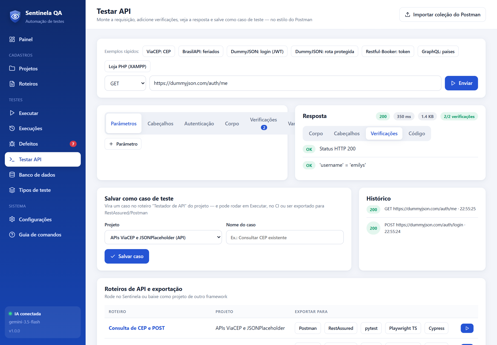

## Todos os tipos de teste e outros frameworks

A tela **Tipos de teste** mostra o catálogo completo (funcional, regressão, API, contrato, Postman, desktop, mobile web,
mobile nativo, unitário, componentes, BDD, exploratório, banco, acessibilidade, desempenho, carga, segurança, visual, links e
usabilidade com IA) e quais ferramentas estão instaladas no PC.

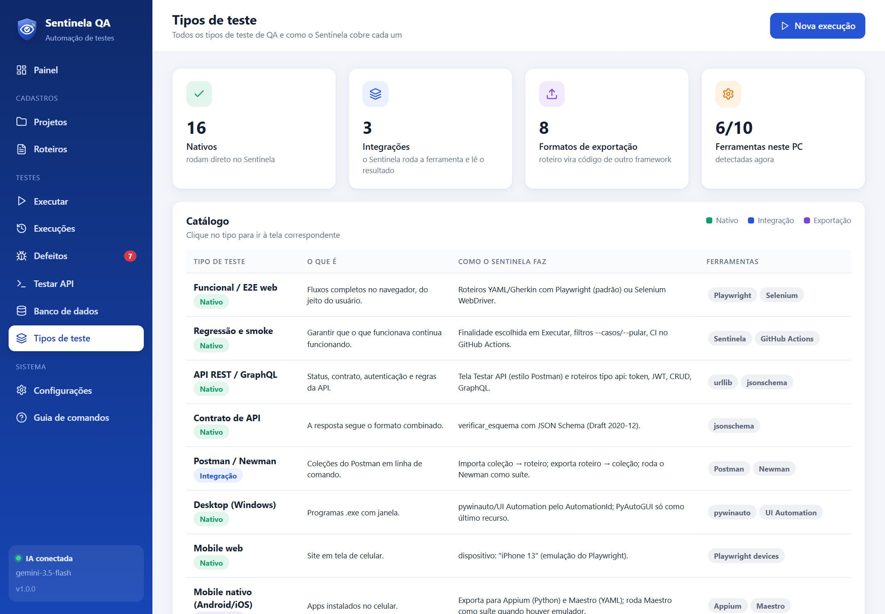

### Três jeitos de usar as ferramentas do mercado

| Jeito | O que faz | Ferramentas |
|---|---|---|
| **Motor alternativo** | o roteiro roda com outra biblioteca: `motor: selenium` | **Selenium WebDriver** (além do Playwright) |
| **Suíte (`tipo: suite`)** | o Sentinela roda a suíte do time e lê o **JUnit XML** — resultados entram no relatório, histórico e defeitos | **Pytest, Jest, Vitest, Cypress, Newman, Playwright TS, JUnit 5/TestNG (Maven), Maestro** |
| **Exportar** | o roteiro vira código pronto do outro framework (`sentinela exportar` ou o menu "Exportar para…") | **Playwright TS, Cypress, Selenium + pytest, pytest + requests, RestAssured + JUnit 5, Postman, Appium, Maestro** |

```yaml
# Suíte de outro framework rodada pelo Sentinela
sistema: Carrinho (testes unitários)
tipo: suite
ferramenta: jest          # pytest | jest | vitest | cypress | newman | playwright-ts | maven | maestro
pasta: ../exemplos_frameworks/jest_unitario
```

```bash
python -m sentinela exportar --roteiro roteiros/web_site_treino.yaml --para cypress --saida exportado/cypress
```

```bash
python -m sentinela postman --colecao minha_colecao.json --arquivo roteiros/minha_api.yaml
```

### Exemplos que rodaram de verdade nesta máquina

| Exemplo (`exemplos_frameworks/`) | Como foi feito | Resultado |
|---|---|---|
| `pytest_unitario` | escrito à mão (regras de preço) | 16 aprovados + **1 bug plantado encontrado** (desconto acima de 100%) |
| `jest_unitario` | escrito à mão (carrinho em JS) | 7 aprovados + **1 bug plantado encontrado** (cupom vencido aceito) |
| `newman_postman` | **exportado** do roteiro ViaCEP | 16/16 verificações no Newman |
| `playwright_ts` | **exportado** do roteiro do site de treino | 6/6 no Playwright TypeScript |
| `selenium_python` | **exportado** do roteiro do site de treino | 6/6 no pytest + Selenium |
| `pytest_api` | **exportado** do roteiro ViaCEP | 4/4 no pytest + requests |
| `cypress` | exportado | pronto (a 1ª execução baixa o Cypress, ~500 MB) |
| `restassured_java` | exportado (projeto Maven) | precisa de JDK 17 + Maven |
| `appium_python`, `maestro` | exportados (web mobile no Android) | precisam de Appium/Maestro + emulador |

> Mobile **nativo** (Appium/Maestro/Detox) precisa de um emulador ou celular; sem isso o Sentinela gera o código e testa o
> **mobile web** com emulação de aparelho (`dispositivo: "iPhone 13"`).

## Qualidade extra

Comandos que usam bibliotecas **gratuitas e open source** — entram em qualquer roteiro web (e os de API em roteiros de API):

| Comando | Exemplo | O que verifica | Biblioteca |
|---|---|---|---|
| `verificar_acessibilidade` | `{ impacto_minimo: serious, max_violacoes: 0 }` | regras **WCAG 2.1 A/AA** (contraste, rótulos, ARIA...) | [axe-core](https://github.com/dequelabs/axe-core) |
| `verificar_esquema` | `{ arquivo: esquemas/produto.json }` | contrato do JSON da API | [jsonschema](https://python-jsonschema.readthedocs.io/) |
| `comparar_visual` | `{ nome: tela_login, tolerancia: 1 }` | **regressão visual**: compara com uma linha de base e destaca as diferenças em vermelho | Pillow |
| `verificar_desempenho` | `{ carregamento_ms: 3000, lcp_ms: 2500 }` | tempo de carregamento, TTFB, **LCP**, nº e peso dos recursos | Navigation Timing API |
| `teste_carga` | `{ url: /api, requisicoes: 50, concorrencia: 10, p95_ms: 800 }` | vazão, média, **p95** e erros sob carga (use só em sistemas seus) | threads do Python |
| `verificar_seguranca` | `{ exigir: [x-content-type-options] }` | cabeçalhos de segurança (CSP, nosniff, clickjacking, HSTS...), versão exposta, flags dos cookies | — |
| `varredura_seguranca` | `{ injecao: [{ url, parametro }], login: { url, campos } }` | **14 pontos OWASP**: painel admin sem login, `.env`/`.git` expostos, segredo no front-end, SQL injection, XSS, login que vaza o papel, força bruta, upload de `.php`, IDOR e preço vindo do cliente (**só em sistemas seus**) | — |
| `verificar_injecao` | `{ url: /busca, parametro: q }` | SQL injection + XSS num único parâmetro | — |
| `verificar_links` | `{ limite: 40 }` | links quebrados (4xx/5xx) | — |

E no cabeçalho do roteiro: `dispositivo: "iPhone 13"` (emulação de celular) e `navegador: msedge`.

> Na Loja PHP de treino, o axe-core encontrou um problema **real** que não foi plantado: contraste de cor insuficiente.

## Banco de dados: auditoria e testes (XAMPP)

### Auditor de estrutura
Na tela **Banco de dados** (ou `python -m sentinela banco auditar --banco nome_do_banco`), o Sentinela conecta no
MySQL/MariaDB com **usuário e senha** e lê a estrutura pelo `information_schema`. Ele **não lê o conteúdo** das tabelas —
só faz contagens (ex.: quantas senhas parecem sem hash, quantos registros órfãos existem).

Para cada problema, o relatório mostra: **o que está errado**, **por que importa**, o **problema futuro provável** 🔮,
**onde agir** (banco, código da aplicação ou servidor) e o **SQL de correção**. Exemplos do que ele encontra:

| Categoria | Exemplos |
|---|---|
| Segurança | usuário root/pma **sem senha**, acesso de qualquer host (`%`), usuário anônimo, **senhas em MD5 ou texto puro** |
| Estrutura | tabela **sem chave primária**, engine **MyISAM**, falta de colunas de auditoria |
| Integridade | relacionamento **sem FOREIGN KEY**, **registros órfãos**, CPF/e-mail **sem UNIQUE** (e duplicados já existentes) |
| Desempenho | coluna de relacionamento **sem índice**, índices redundantes, arquivos em BLOB |
| Tipos de dados | **dinheiro em FLOAT**, **data guardada como texto**, charset sem utf8mb4 |
| Futuro | AUTO_INCREMENT perto do limite, **crescimento previsto em 12 meses** por tabela |
| Servidor | versão sem suporte, `sql_mode` não estrito, log de consultas lentas desligado |

Extras: **nota de saúde (0–100)**, **diagrama de relacionamentos** (inclusive os que só existem no código, tracejados),
script `correcoes_sugeridas.sql` e, opcionalmente, uma **análise da IA** que recebe **só a estrutura** (nomes e tipos).

### Aplicando correções (com segurança)
As correções seguras aparecem com caixa de seleção. Para aplicar, você marca as que quer e **digita o nome do banco**
para confirmar. Antes de qualquer alteração o Sentinela faz um **backup automático com mysqldump** (em `dados/backups`),
e a tela permite **restaurar** o backup. Correções que exigem limpeza de dados antes (ex.: transformar data em texto em
DATETIME) ficam só como sugestão comentada — nunca são aplicadas sozinhas.

```bash
python -m sentinela banco auditar --banco sentinela_loja --ia
```

```bash
python -m sentinela banco aplicar --banco sentinela_loja --correcoes C006,C013 --confirmar
```

> No banco de treino, aplicar 5 correções (MyISAM→InnoDB, chave primária, FLOAT→DECIMAL, índice e UNIQUE) levou a nota de 35 para 44.

### Conferindo o banco dentro dos testes
Num roteiro, configure a conexão e use os comandos de banco para provar que a ação na tela/API **gravou certo**:

```yaml
banco: { host: 127.0.0.1, usuario: root, senha: "{env.SENTINELA_DB_SENHA|}", nome: sentinela_loja }
...
      - verificar_banco: { sql: "SELECT ROUND(preco, 2) FROM produtos WHERE nome = '{dados.produto}'", valor: "19.9" }
      - consultar_banco: { sql: "SELECT COUNT(*) FROM produtos", guardar_como: total_banco }
      - preparar_banco: "DELETE FROM produtos WHERE nome LIKE 'TESTE %'"
```

`verificar_banco` e `consultar_banco` só aceitam leitura (SELECT); só `preparar_banco` altera dados.

> **Segurança:** a credencial fica só na memória do painel (ou no `.env`, se você marcar "lembrar"). O XAMPP vem com
> root sem senha — o próprio auditor aponta isso como **Crítico** e mostra como criar um usuário só para a aplicação.

## Sistemas de treino

| Sistema | Tecnologia | Como subir | Bugs plantados |
|---|---|---|---|
| **Loja Treino** (`site_treino/`) | HTML + JS | `python -m sentinela site-treino` (o painel sobe sozinho) | telefone sem validação |
| **Loja PHP** (`sistemas_treino/loja_php/`) | PHP 8 + MySQL (XAMPP) + API REST | `python -m sentinela xampp instalar` | preço negativo e estoque com letras aceitos; banco com MyISAM, FLOAT, sem FKs, órfãos, senha MD5 |
| **Estoque Desktop** (`sistemas_treino/estoque_desktop/`) | C# Windows Forms | compilado sozinho com o `csc.exe` do Windows | quantidade negativa aceita |

`sentinela xampp iniciar` liga MySQL e Apache; `sentinela xampp instalar` recria o banco `sentinela_loja` e copia o
sistema para `htdocs/sentinela-loja` (usuário `qa@loja.test` / `treino123`, fictícios).

## APIs públicas gratuitas

O roteiro `roteiros/api_publicas.yaml` usa só APIs **gratuitas e sem chave**:

| API | O que o roteiro testa |
|---|---|
| [BrasilAPI](https://brasilapi.com.br) | CEP, feriados nacionais, bancos |
| [Restful-Booker](https://restful-booker.herokuapp.com) | login com token + **CRUD** de reserva (criar, alterar, excluir, conferir 404) |
| [DummyJSON](https://dummyjson.com) | login **JWT** e rota protegida (com token válido e inválido) |
| [PokeAPI](https://pokeapi.co) | **contrato JSON** (JSON Schema) |
| [Countries GraphQL](https://countries.trevorblades.com) | consulta **GraphQL** |
| [Open-Meteo](https://open-meteo.com) | clima atual (parâmetros de consulta) |

Nenhuma chave é necessária. A única chave do projeto continua sendo a do Gemini (opcional).

## Configurando a IA

A IA é **opcional**. Sem chave, o Sentinela roda normalmente e avisa no relatório que a seção
"Melhorias e ideias" não foi gerada.

1. Crie uma chave gratuita no [Google AI Studio](https://aistudio.google.com/apikey).
2. Copie `.env.exemplo` para `.env` (na pasta de onde você roda o Sentinela ou ao lado do `.exe`).
3. Preencha:

```ini
GEMINI_API_KEY=sua_chave_aqui
SENTINELA_IA=gemini
SENTINELA_MODELO_IA=gemini-3.5-flash
```

O `.env` está no `.gitignore` — **a chave nunca vai para o código nem para o GitHub**.
Também dá para definir as variáveis direto no Windows ou nos *Secrets* do GitHub Actions.

O Sentinela envia à IA o resumo da execução e até 6 prints (priorizando os de falha) e pede sugestões
de **usabilidade, texto, acessibilidade e funcionalidade**. No relatório elas aparecem marcadas como
**sugestão**: precisam de avaliação humana antes de virar requisito ou defeito.

> ⚠️ Não envie para a IA prints com dados reais/sensíveis. Use ambientes de teste.

## Lendo o relatório

Cada execução cria `relatorios/<sistema>_<data_hora>/` com:

```
relatorio.html   ← abra no navegador
relatorio.json   ← para integrar com outras ferramentas
relatorio.txt    ← para colar em e-mail / Jira
prints/          ← um PNG por passo
```

Seções do HTML:

| Seção | O que tem |
|---|---|
| **Cabeçalho** | sistema, versão, data, responsável, ambiente (com navegador e versão), alvo, duração |
| **Resumo** | total de casos, aprovados, reprovados, defeitos, observações, sugestões e veredito |
| **Objetivo** | objetivo e funcionalidades com critérios de aceitação |
| **Testes realizados** | ID, descrição, passos, esperado, obtido, status **APROVADO/REPROVADO** e print |
| **Erros e bugs** | ID, descrição, **severidade**, status, passos para reproduzir, esperado × obtido, **evidência** |
| **O que foi encontrado** | acessibilidade básica, erros de console/rede, resultado da exploração |
| **Melhorias e ideias** | sugestões da IA (marcadas como sugestão) |
| **Caminho percorrido** | cada ação, em ordem, com horário, resultado, tempo e print (clique para ampliar) |

Um caso é **REPROVADO** quando qualquer passo falha (elemento não encontrado no tempo limite ou
verificação que não bate). Os passos seguintes daquele caso não são executados, e um defeito é aberto
automaticamente com a severidade do caso. Exemplos prontos em [`exemplos_de_relatorio/`](exemplos_de_relatorio/)
e **ao vivo** em [zrebouca.github.io/sentinela-qa](https://zrebouca.github.io/sentinela-qa/).

### Exportando defeitos
- **CSV** (abre no Excel): botão *Exportar CSV* na tela **Defeitos** — respeita os filtros aplicados.
- **Jira**: na página de cada defeito, *Levar para o Jira* gera o texto no formato do Jira (passos numerados,
  esperado, obtido e evidência) com um botão *Copiar texto*.

## CI/CD

O workflow [`.github/workflows/testes.yml`](.github/workflows/testes.yml) roda a cada push:

| Etapa | Obrigatória? |
|---|---|
| Testes unitários + **teste de integração** (Chrome de verdade no site de treino) | ✅ sim |
| Regressão no site de treino pela linha de comando | ✅ sim |
| The Internet (com `--pular CT09`, a falha proposital), APIs, Sauce Demo com exploração | informativa (sites de terceiros) |

Os relatórios ficam em **Actions → execução → Artifacts**. Filtros úteis para pipelines:
`--casos CT01,CT02` (roda só esses) e `--pular CT09` (ignora esses). O código de saída é `1` quando há falha.

## Gerando o .exe

```bash
powershell -ExecutionPolicy Bypass -File build_exe.ps1
```

Resultado: `dist\sentinela\` com `sentinela.exe`, `roteiros\`, `.env.exemplo` e este README.
Copie a pasta inteira para outro Windows com Chrome ou Edge e use (não precisa de Python).

- Dois cliques no `.exe` → abre o painel no navegador (a janela preta do console precisa ficar aberta; fechá-la encerra o painel).
- No terminal → `sentinela.exe rodar --roteiro roteiros\web_saucedemo.yaml`.

## Estrutura do projeto

```
sentinela/
  cli.py               linha de comando (painel, rodar, validar, novo, gherkin, site-treino)
  executor_api.py      testes de API (REST/JSON) sem navegador
  executor_selenium.py motor web alternativo com Selenium WebDriver
  executor_suite.py    roda suítes de Pytest, Jest, Vitest, Cypress, Newman, Playwright TS, Maven e Maestro (JUnit XML)
  exportar.py          converte roteiros em Playwright TS, Cypress, Selenium, pytest, RestAssured, Postman, Appium e Maestro
  postman.py           importa/exporta coleções do Postman v2.1
  executor_banco.py    verificar_banco / consultar_banco / preparar_banco nos roteiros
  executor_qualidade.py  acessibilidade (axe), JSON Schema, visual, desempenho, carga, segurança, links
  banco_auditor.py     auditoria de estrutura MySQL/MariaDB, previsões, backup e correções
  xampp.py             liga o XAMPP e instala a Loja PHP de treino
  gherkin.py           leitura de .feature em português e conversão YAML → Gherkin
  painel/              painel web (Flask + SQLite)
    app.py             rotas das telas e da API interna
    banco.py           tabelas: projetos, roteiros, execucoes, defeitos, atividades
    fila.py            fila de execuções (uma por vez, log ao vivo)
    templates/ static/ telas HTML e estilo
  motor.py             orquestra: roteiro → executor → exploração → IA → relatório
  roteiro.py           leitura e validação do YAML/JSON (mensagens de erro em português)
  executor_base.py     roda casos, prints, APROVADO/REPROVADO, abre defeitos
  executor_web.py      Playwright (seletores estáveis, esperas automáticas, acessibilidade)
  executor_desktop.py  pywinauto UIA (PyAutoGUI só por coordenada, último recurso)
  exploracao.py        tentativas com dados inválidos
  dados.py             Faker pt_BR, marcadores {faker.x} {env.x} {dados.x}, validação de CPF
  ia.py                análise com Gemini (google-genai)
  relatorio.py         HTML (Jinja2), JSON e TXT
  templates/relatorio.html.j2
roteiros/              exemplos (web, desktop, API e Gherkin)
site_treino/           lojinha local para praticar e para o CI (com um bug plantado)
sistemas_treino/       Loja PHP + MySQL (XAMPP) e Estoque Desktop (C# WinForms), com bugs plantados
exemplos_frameworks/   suítes de exemplo em Pytest e Jest + código exportado para Playwright TS, Cypress, Selenium,
                       pytest, RestAssured, Postman/Newman, Appium e Maestro
tests/                 testes unitários e de integração (pytest)
docs/                  site do GitHub Pages (demo + relatórios ao vivo) e imagens do README
.github/workflows/     CI: testes + regressão a cada push, relatórios como artifact
```

Rodar os testes unitários:

```bash
pytest -q                      # tudo (inclui integração, abre o Chrome)
```

```bash
pytest -q -m "not integracao"  # só os rápidos
```

## Boas práticas que o projeto segue

- Nada de senha, chave ou dado real no código ou nos roteiros — use `{env.X}` + `.env`.
- Só automatize **sites de demonstração** ou sistemas que você tem autorização para testar.
- Cada caso de teste web roda em **sessão limpa** (sem cookies do caso anterior) — casos independentes.
- Prefira **verificações** a **esperas fixas**.

---

Feito por **Mateus** — projeto de portfólio de QA. Sugestões e issues são bem-vindas!
